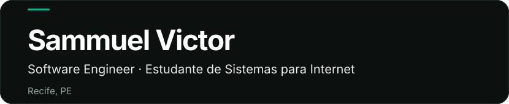
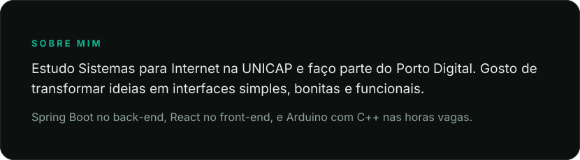

  <a href="https://www.linkedin.com/in/sammuel-victor/">Linkedin</a>&nbsp;&nbsp;
  <a href="https://www.instagram.com/samv1ctor">Instagram</a>&nbsp;&nbsp;
  <a href="https://sammuelvictor.vercel.app/">Vercel</a>&nbsp;&nbsp;
  <a href="mailto:samvss13@gmail.com">Gmail</a>

  

  

  

Sempre estudando algo novo.

