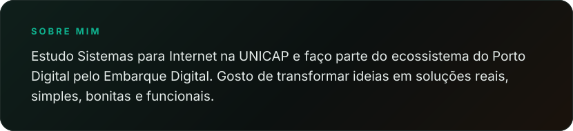

  <tr>
    <td align="center" width="110">
      
       
      <a href="https://www.linkedin.com/in/sammuel-victor/"><b>LinkedIn</b></a>
    </td>
    <td align="center" width="110">
      
       
      <a href="https://www.instagram.com/samv1ctor"><b>Instagram</b></a>
    </td>
    <td align="center" width="110">
      
       
      <a href="https://sammuelvictor.vercel.app/"><b>Portfólio</b></a>
    </td>
    <td align="center" width="110">
      
       
      <a href="mailto:samvss13@gmail.com"><b>E-mail</b></a>
    </td>
  </tr>

  

  

  

Sempre estudando algo novo.

